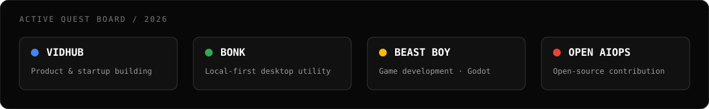
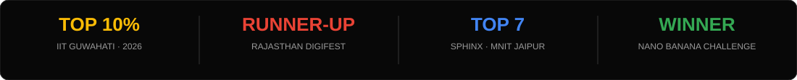
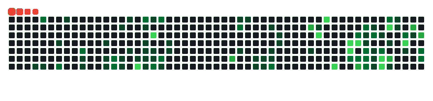

<!--
  VAIBHAV SONI | BLACK / SHINOBI / GOOGLE / GITHUB
  Profile README for: github.com/VaibhavSoni24
  Local graphics: ./assets/
-->

 

  

---

## `01 / THE DEVELOPER`

I'm **Vaibhav Soni**, a Computer Science undergraduate and builder from Jaipur, India.

I enjoy turning complex problems into useful software - from AI-powered applications and developer tools to games and full-stack products. I care about practical engineering, thoughtful interfaces, and systems that solve real problems.

- Currently building: **VidHub**, **Bonk**, and **Beast Boy: The Last Hope**
- Exploring: AI agents, applied machine learning, full-stack engineering, and game development
- Community: **Google Gemini Student Ambassador**
- Open source: Contributor to **OpenAIOps**
- Education: B.Tech, Computer Science & Engineering - Arya College of Engineering (Main Campus), Jaipur

> **My way of building:** learn deeply - build deliberately - iterate relentlessly.

## `02 / CURRENT QUESTS`

  

| Quest | Focus |
|---|---|
| [VidHub](https://github.com/VidHub-Dev) | Building a platform for video editors |
| [Bonk](https://github.com/VaibhavSoni24/Bonk) | Local-first desktop utility driven by physical sound |
| [Beast Boy: The Last Hope](https://github.com/VaibhavSoni24/Beast-Boy-The-Last-Hope) | Developing an original game in Godot |
| [OpenAIOps](https://github.com/VaibhavSoni24/open-aiops) | Open-source platform for production-ready AI applications |

## `03 / SELECTED BUILDS`

A few projects that represent the kind of problems I like working on.

<table>
  <tr>
    <td width="50%" valign="top">
      <h3><a href="https://github.com/VaibhavSoni24/CivicSaathi">CivicSaathi</a></h3>
      AI-powered municipal complaint management: complaint verification, duplicate detection, smart routing, and SLA-driven escalation.
        Python · Django REST · Next.js · Gemini  
      <strong>Recognition:</strong> Runner-up, Rajasthan Digifest x TiE Global Hackathon.
    </td>
    <td width="50%" valign="top">
      <h3><a href="https://github.com/VaibhavSoni24/CodeConcept">CodeConcept</a></h3>
      An AI-assisted learning platform focused on understanding conceptual mistakes in code, with execution, static analysis, AST visualization, and guided feedback.
        FastAPI · React · Vite · Monaco Editor  [Repository](https://github.com/VaibhavSoni24/CodeConcept)
    </td>
  </tr>
  <tr>
    <td width="50%" valign="top">
      <h3><a href="https://github.com/VaibhavSoni24/VisionSentinel">Vision Sentinel</a></h3>
      Evidence-driven verification and inspection that combines computer vision with a closed-loop decision engine.
        Python · OpenCV · AI  [Repository](https://github.com/VaibhavSoni24/VisionSentinel)
    </td>
    <td width="50%" valign="top">
      <h3><a href="https://github.com/VaibhavSoni24/Impulse">IMPULSE</a></h3>
      An autonomous software-engineering agent for repository-level issue resolution and regression validation.
        Python · Agentic systems · Google ADK  [Repository](https://github.com/VaibhavSoni24/Impulse)
    </td>
  </tr>
  <tr>
    <td width="50%" valign="top">
      <h3><a href="https://github.com/VaibhavSoni24/Phase-Drop">Phase Drop</a></h3>
      A privacy-focused Windows utility for converting, editing, compressing, and managing files through a radial drag-and-drop menu.
        Windows · Desktop engineering  [Repository](https://github.com/VaibhavSoni24/Phase-Drop)
    </td>
    <td width="50%" valign="top">
      <h3><a href="https://github.com/VaibhavSoni24/ZYNC">Zync</a></h3>
      A synchronized watch-party platform with live chat, granular permissions, and expressive real-time interactions.
        Web · Realtime · WebGL  [Repository](https://github.com/VaibhavSoni24/ZYNC) · [Live demo](https://zync-watch-party.vercel.app/)
    </td>
  </tr>
</table>

  
<strong>More projects</strong>

   
  - [ToxiScan AI](https://github.com/VaibhavSoni24/ToxiScan-AI) - drug-toxicity prediction with ML and explainability.
  - [DesignGuard AI](https://github.com/VaibhavSoni24/DesignGuard-AI) - CAD design validation and AI-assisted recommendations.
  - [Nexus](https://github.com/VaibhavSoni24/Nexus) - [Live demo](https://nexus-gilt-xi.vercel.app/) - autonomous Slack agent network.
  - [SchemeSetu](https://github.com/VaibhavSoni24/SchemeSetu) - vernacular-first government-scheme discovery.
  - [OpenSquare](https://github.com/VaibhavSoni24/OpenSquare) - 3D anime-inspired open-world browser game.
  - [Marvel Multiverse Roadmap](https://github.com/VaibhavSoni24/Marvel-Roadmap) - [Live website](https://marvel-multiverse-roadmap.vercel.app/) - release-order viewing guide across Marvel universes.
  - [Undead Survival](https://github.com/VaibhavSoni24/Vortalis_Game) - [Play on itch.io](https://lastword.itch.io/undead-survival) - multiplayer top-down zombie survival game.
  - [Math Slam: Basketball Jam](https://github.com/VaibhavSoni24/Math-Slam-Basketball-Jam-V2) - [Play online](https://vaibhavsoni24.github.io/Math-Slam-Basketball-Jam-V2/) - multiplayer educational arcade game built with Phaser 4.
  - [DreamWeaver](https://github.com/VaibhavSoni24/DreamWeaver) - [Live demo](https://dreamweaverofficial.netlify.app/) - branching AI story generator.

## `04 / THE TOOLKIT`

  

**Languages:** Python, C, C++, Java, JavaScript, TypeScript, SQL, GDScript, C#, Dart  
**Web & backend:** React, Next.js, Node.js, Express, Django, Flask, FastAPI, REST APIs  
**AI & data:** Machine Learning, PyTorch, TensorFlow, OpenCV, scikit-learn, Pandas, Gemini API  
**Platforms & tools:** Git, GitHub, Docker, PostgreSQL, SQLite, Firebase, Supabase, Godot, Unity

## `05 / ACHIEVEMENTS & SIGNALS`

| Recognition | Result |
|---|---|
| IIT Guwahati - Summer Analytics 2026 | Top 10 percentile |
| IIT Guwahati - Summer Analytics 2025 | Top 25 percentile |
| Rajasthan Digifest x TiE Global Hackathon | Runner-up - CivicSaathi |
| Sphinx, MNIT Jaipur Hackathon | Top 7 - Real-Time Call / Meeting Analyzer |
| Enigma, RIET Hackathon | Top 10 - CivicSaathi |
| ET AI Hackathon | Semifinalist - CivicSaathi |
| HackJKLU | Top 30 - CodeConcept |
| Nano Banana Challenge | Winner - September 2026 |
| XERJ Corpus Hub | Selected contributor; 499-line Python Pricing Registry indexed as an attributed reference |

**Experience & community**

- **Google Gemini Student Ambassador** - supporting student learning and adoption of Gemini.
- **Open-source contributor, OpenAIOps** - contributing to observability and platform engineering.
- **Founder, VidHub** - building a platform for video editors.
- **Game Developer Intern, Vortalis Technologies** - developed *Undead Survival* for GMTK Game Jam.
- **AI Trainer Intern, Aerophantom** - taught AI automation and sensor/transistor-based projects.
- **Web Development Intern, CollegeTips.in** - contributed to the frontend of the company website.

## `06 / LEARNING LOG`

Research and structured learning keep me curious.

- **SortSearch** - research on integrating target detection into the sorting/merge process.
- **Decarbonizing Travel** - predictive carbon-management framework for corporate travel, developed as the IIT Guwahati Summer Analytics 2026 capstone.
- **OpenAIOps** - learning and contributing to reliable, observable AI application infrastructure.

## `07 / GITHUB ACTIVITY`

### Contribution trail

  

## `08 / THE SHINOBI WAY`

  
   
  Inspired by the worlds of anime, science, games, and the people who keep building.

---

### FIND ME AROUND THE WEB

  

Designed with a black canvas, a shinobi mindset, Google's colour language, and GitHub-native building blocks.

